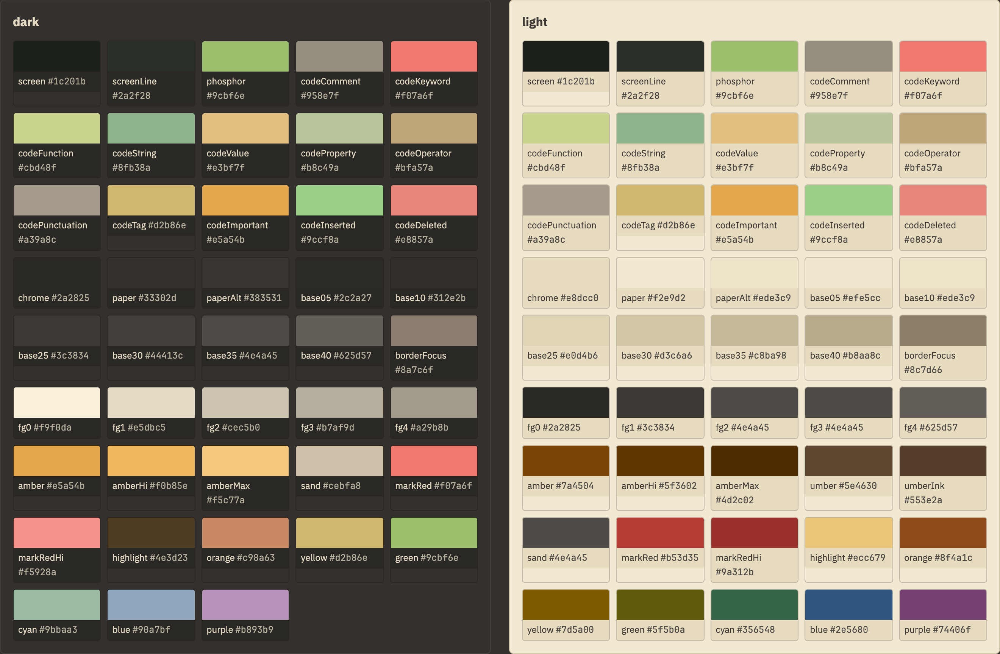
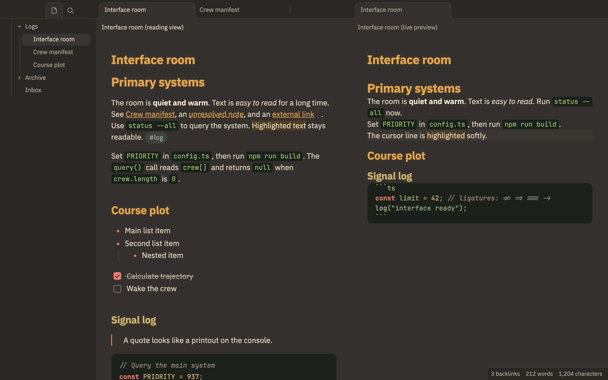
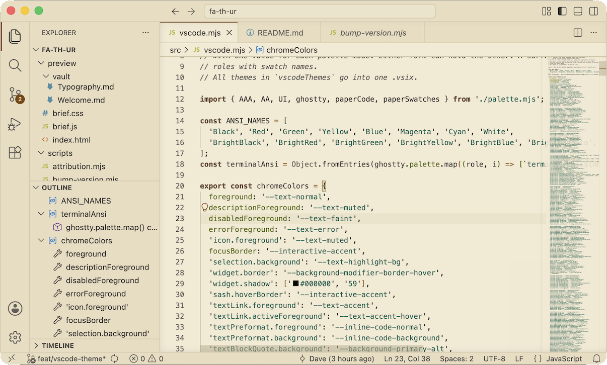
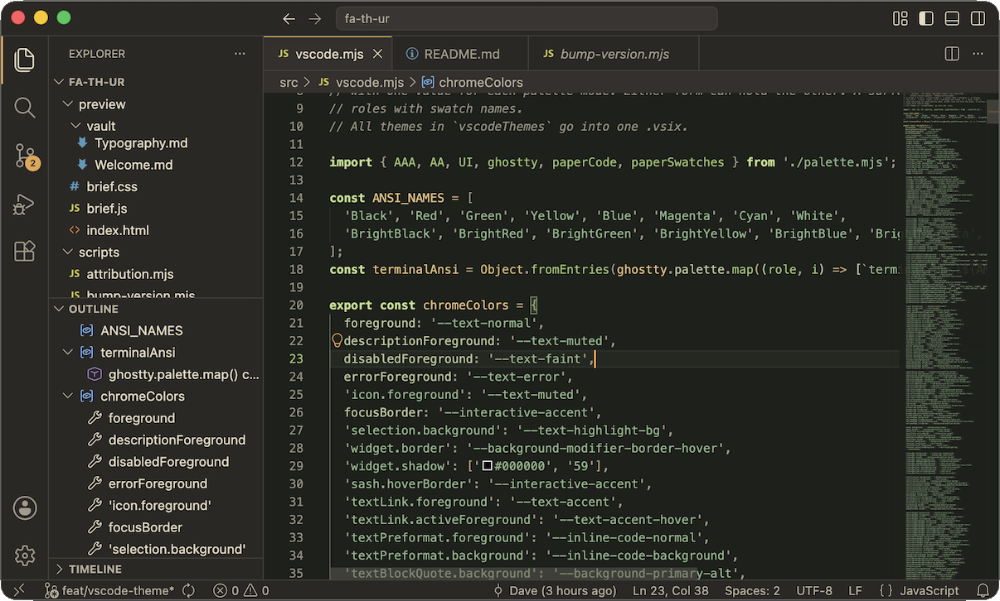

# fa-th-ur

A warm, minimal, accessible theme framework. One palette in `src/palette.mjs` makes light and dark themes for each supported app. 



## Build

```sh
npm install
npm run fonts:fetch   # optional: refreshes src/fonts from upstream
npm run build         # contrast check, font embedding, all app themes in dist/
npm run build:<app>   # contrast check and one app
```

The build stops when a color pair fails its contrast minimum.

## Preview

Open `preview/index.html` in a browser after a build. The page shows the palette, the contrast results, and the type specimens.

## Obsidian

The Obsidian theme has no plugins and makes no network requests. The fonts are embedded in `theme.css`.

`manifest.json` stays at the repository root because the Obsidian community theme directory reads it there.




### Install

1. Download `obsidian_fa-th-ur_v<version>.zip` from [Releases](https://github.com/enmande/fa-th-ur/releases) and unzip it. Or run the steps in [Build](#build): the build writes the theme into `dist/obsidian/`.
2. Copy the folder `fa-th-ur/` into `<vault>/.obsidian/themes/`.
3. Select "fa-th-ur" in Settings > Appearance > Themes.

The folder name must be exactly `fa-th-ur`. Obsidian loads a theme only when its folder name matches the `name` in `manifest.json`.


### Trial vault

`preview/vault/` is a style sheet vault: sample notes for each Markdown feature, a canvas, and an image. Each build copies the theme into `preview/vault/.obsidian/themes/fa-th-ur/`. The first build also selects it.

1. Run `npm run build`.
2. In Obsidian, select "Open folder as vault" and choose `preview/vault`.
3. Start with the `Welcome` note.

## Ghostty

### Install

There are two Ghostty themes: `fa-th-ur light` and `fa-th-ur dark`.

1. Download `ghostty_fa-th-ur_v<version>.zip` from [Releases](https://github.com/enmande/fa-th-ur/releases) and unzip it. Or run the steps in [Build](#build): the build writes the themes into `dist/ghostty/`.
2. Copy both theme files into `~/.config/ghostty/themes/`.
3. Add this line to the Ghostty config:

   ```
   theme = "light:fa-th-ur light,dark:fa-th-ur dark"
   ```

Ghostty then follows the light or dark appearance of the system.

## VS Code

One `.vsix` holds both VS Code light and dark themes in `vscodeThemes` in `src/apps/vscode.mjs`.





### Install

1. Download `vscode_fa-th-ur_v<version>.zip` from [Releases](https://github.com/enmande/fa-th-ur/releases) and unzip it. Alternatively, [build](#build) from source: the build writes the VSIX into `dist/vscode/`.
2. Run `code --install-extension fa-th-ur-<version>.vsix`.
3. Select the theme in Preferences > Theme > Color Theme.

## License

The code and the themes use the MIT License. See `LICENSE`.

The Obsidian theme embeds fonts that use the SIL Open Font License 1.1. See `LICENSE-FONTS.md` for each font, its copyright, and its embedded form.

## Credits

- [JetBrains Mono](https://github.com/JetBrains/JetBrainsMono) by The JetBrains Mono Project Authors.
- [IBM Plex Sans](https://github.com/IBM/plex) by IBM Corp.
