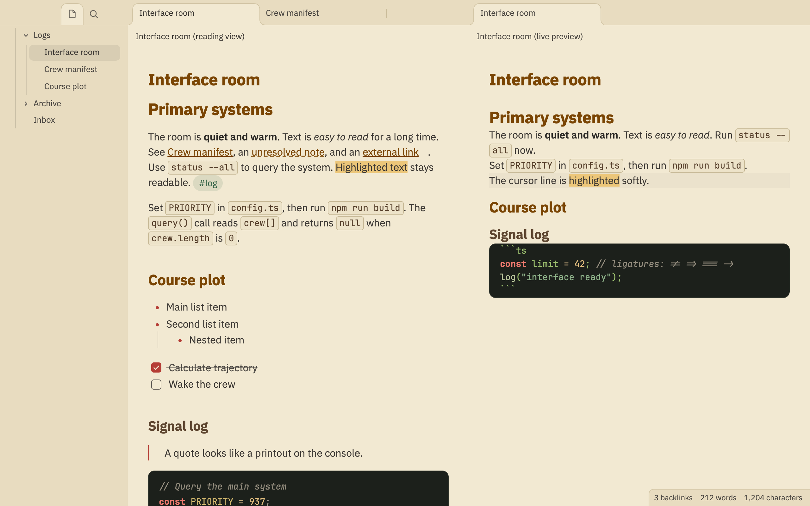

# fa-th-ur

A warm, minimal, accessible theme framework. One palette in `src/palette.mjs` makes light and dark themes for each supported app. The build checks a contrast minimum for each listed color pair.

| App | Output |
|---|---|
| Obsidian | `dist/obsidian/fa-th-ur/` |
| Ghostty | `dist/ghostty/` |
| VS Code | `dist/vscode/fa-th-ur-<version>.vsix` |


## Build

```sh
npm install
npm run fonts:fetch   # optional: refreshes src/fonts from upstream
npm run build         # contrast check, font embedding, all app themes in dist/
```

The build stops when a color pair fails its contrast minimum.

## Where to change things

| Change | File |
|---|---|
| Colors and contrast pairs | `src/palette.mjs` |
| Ghostty color keys | `src/palette.mjs` (`ghostty`) |
| VS Code themes and color keys | `src/vscode.mjs` |
| Fonts and font subsets (Obsidian) | `src/fonts.mjs` |
| Obsidian styles that are not colors | `src/css/*.css` |

## Obsidian

The Obsidian theme has no plugins and makes no network requests. The fonts are embedded in `theme.css`.




### Install (manual)

1. Download `obsidian_fa-th-ur_v<version>.zip` from [Releases](https://github.com/enmande/fa-th-ur/releases) and unzip it. Or run the steps in [Build](#build): the build writes the theme into `dist/obsidian/`.
2. Copy the folder `fa-th-ur/` into `<vault>/.obsidian/themes/`.
3. Select "fa-th-ur" in Settings > Appearance > Themes.

The folder name must be exactly `fa-th-ur`. Obsidian loads a theme only when its folder name matches the `name` in `manifest.json`.

### Preview

Open `preview/index.html` in a browser after a build. The page shows the palette, the contrast results, and the type specimens. To see the theme in Obsidian, use the trial vault.

### Trial vault

`preview/vault/` is a style sheet vault: sample notes for each Markdown feature, a canvas, and an image. Each build copies the theme into `preview/vault/.obsidian/themes/fa-th-ur/`. The first build also selects it.

1. Run `npm run build`.
2. In Obsidian, select "Open folder as vault" and choose `preview/vault`.
3. Start with the `Welcome` note.

## Ghostty

There are two Ghostty themes: `fa-th-ur light` and `fa-th-ur dark`.

1. Download `ghostty_fa-th-ur_v<version>.zip` from [Releases](https://github.com/enmande/fa-th-ur/releases) and unzip it. Or run the steps in [Build](#build): the build writes the themes into `dist/ghostty/`.
2. Copy both theme files into `~/.config/ghostty/themes/`.
3. Add this line to the Ghostty config:

   ```
   theme = light:fa-th-ur light,dark:fa-th-ur dark
   ```

Ghostty then follows the light or dark appearance of the system. The terminal text colors map to roles in `src/palette.mjs` that have contrast pairs.

## VS Code

One `.vsix` holds all the VS Code themes in `vscodeThemes` in `src/vscode.mjs`.

| Theme | Workbench and floating widgets | Editor surface |
|---|---|---|
| fa-th-ur dark | Dark palette | Code screen (phosphor) |
| fa-th-ur light | Light palette | Paper (`paperCode` in `src/palette.mjs`) |

1. Download `vscode_fa-th-ur_v<version>.zip` from [Releases](https://github.com/enmande/fa-th-ur/releases) and unzip it. Or run the steps in [Build](#build).
2. Run `code --install-extension fa-th-ur-<version>.vsix`.
3. Select the theme in Preferences > Theme > Color Theme.

To add a theme, add an entry to `vscodeThemes`. Each entry names a `chrome` palette mode and an editor `surface` from `surfaces`. The build checks the pairs in `vscodePairs` for each theme.

## License

The code and the themes use the MIT License. See `LICENSE`.

The Obsidian theme embeds fonts that use the SIL Open Font License 1.1. See `LICENSE-FONTS.md` for each font, its copyright, and its embedded form.

## Credits

- [Gruvbox](https://github.com/morhetz/gruvbox) by Pavel Pertsev and [Gruvbox Material](https://github.com/sainnhe/gruvbox-material) by sainnhe are the inspiration for the soft blacks and the ambers.
- [JetBrains Mono](https://github.com/JetBrains/JetBrainsMono) by The JetBrains Mono Project Authors.
- [IBM Plex Sans](https://github.com/IBM/plex) by IBM Corp.
