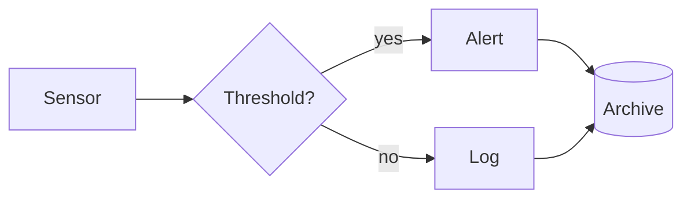

---
tags:
  - style-sheet
---

# Embeds and media

## Note embed

![[Typography#Quotes]]

## Block embed

![[Logs/Interface room#^status]]

## Image

![[panel.svg|360]]

## Math

Inline math: $E = mc^2$ and $\sum_{i=1}^{n} x_i$.

$$
\bar{x} = \frac{1}{n} \sum_{i=1}^{n} x_i \qquad \sigma = \sqrt{\frac{1}{n} \sum_{i=1}^{n} (x_i - \bar{x})^2}
$$

## Diagram



## Search query

```query
lorem
```
