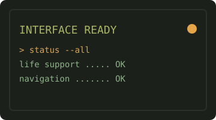

---
tags:
  - style-sheet
---

<h1>HTML elements</h1>

A style sheet for each common HTML element. Lorem ipsum dolor sit amet, consectetur adipiscing elit.

<h2>Headings</h2>

<h1>Heading 1</h1>
<h2>Heading 2</h2>
<h3>Heading 3</h3>
<h4>Heading 4</h4>
<h5>Heading 5</h5>
<h6>Heading 6</h6>

<h2>Text-level elements</h2>

A <a href="https://obsidian.md">link</a>, <abbr title="Simplified Technical English">STE</abbr>, <b>b</b>, <strong>strong</strong>, <i>i</i>, <em>em</em>, <u>u</u>, <s>s</s>, <del>del</del>, <ins>ins</ins>, <mark>mark</mark>, <small>small</small>, H2O, E = mc2, <kbd>Cmd</kbd> + <kbd>P</kbd>, <code>code</code>, <samp>samp output</samp>, <var>x</var>, <q>an inline quote</q>, <cite>A Cited Work</cite>, <dfn>dfn term</dfn>, <time datetime="2026-11-12">12 November 2026</time>, <bdo dir="rtl">bdo text</bdo>, and a line break.

<h2>Paragraphs</h2>

Lorem ipsum dolor sit amet, consectetur adipiscing elit. Sed do eiusmod tempor incididunt ut labore et dolore magna aliqua. Ut enim ad minim veniam, quis nostrud exercitation ullamco laboris nisi ut aliquip ex ea commodo consequat.

Duis aute irure dolor in reprehenderit in voluptate velit esse cillum dolore eu fugiat nulla pariatur. Excepteur sint occaecat cupidatat non proident.

<h2>Quote</h2>

<blockquote cite="https://example.com">

Lorem ipsum dolor sit amet, consectetur adipiscing elit. Vestibulum ante ipsum primis in faucibus.

<footer>— <cite>Lorem Ipsum</cite></footer>
</blockquote>

<h2>Lists</h2>

<ul>
<li>Unordered item</li>
<li>Unordered item with a nested list
<ul>
<li>Nested item</li>
<li>Nested item</li>
</ul>
</li>
<li>Unordered item</li>
</ul>

<ol>
<li>Ordered item</li>
<li>Ordered item with a nested list
<ol type="a">
<li>Nested item (type a)</li>
<li>Nested item (type a)</li>
</ol>
</li>
<li>Ordered item</li>
</ol>

<ol start="7" reversed>
<li>Reversed, starts at 7</li>
<li>Next item</li>
<li>Last item</li>
</ol>

<dl>
<dt>Definition term</dt>
<dd>Definition description. Lorem ipsum dolor sit amet.</dd>
<dt>Second term</dt>
<dd>First description of the second term.</dd>
<dd>Second description of the second term.</dd>
</dl>

<h2>Preformatted text</h2>

<pre><code>function query(crew) {
  return crew.length !== 0 ? "awake" : "asleep";
}</code></pre>

<pre>Plain pre without code.
┌──────────┐
│ ░▒▓ OK ▓▒░ │
└──────────┘</pre>

<h2>Table</h2>

<table>
<caption>System status (caption)</caption>
<thead>
<tr><th>Unit</th><th>State</th><th colspan="2">Load (colspan 2)</th></tr>
</thead>
<tbody>
<tr><td>Life support</td><td>Nominal</td><td>42%</td><td rowspan="2">rowspan 2</td></tr>
<tr><td>Navigation</td><td>Standby</td><td>7%</td></tr>
<tr><td>Engines</td><td><mark>Alert</mark></td><td>88%</td><td><a href="https://obsidian.md">link</a></td></tr>
</tbody>
<tfoot>
<tr><td>Total</td><td>—</td><td>137%</td><td>footer row</td></tr>
</tfoot>
</table>

<h2>Disclosure</h2>

Closed details (click to open)

Lorem ipsum dolor sit amet, consectetur adipiscing elit.

Open details

Consectetur adipiscing elit. Sed do eiusmod tempor.

<h2>Figure and image</h2>

<figure>

<figcaption>Figure caption. The image source is panel.svg in the vault root.</figcaption>
</figure>

<h2>Forms</h2>

<form>
<fieldset>
<legend>Legend</legend>

<label>Text input <input type="text" placeholder="Placeholder text"></label>

<label><input type="checkbox" checked> Checked checkbox</label> <label><input type="checkbox"> Empty checkbox</label>

<label><input type="radio" name="r" checked> Radio one</label> <label><input type="radio" name="r"> Radio two</label>

<label>Select <select><option>Option one</option><option>Option two</option></select></label>

<label>Text area <textarea rows="3" cols="40">Lorem ipsum dolor sit amet.</textarea></label>

<button type="button">Button</button> <input type="submit" value="Submit"> <input type="range">

</fieldset>
</form>

<h2>Meters</h2>

<label>Progress <progress value="70" max="100">70%</progress></label>

<label>Meter <meter value="0.6" min="0" max="1">60%</meter></label>

<h2>Other elements</h2>

<address>Interface room, Deck C Lorem Station</address>

A span. A span with an inline style.

End of the HTML style sheet.

